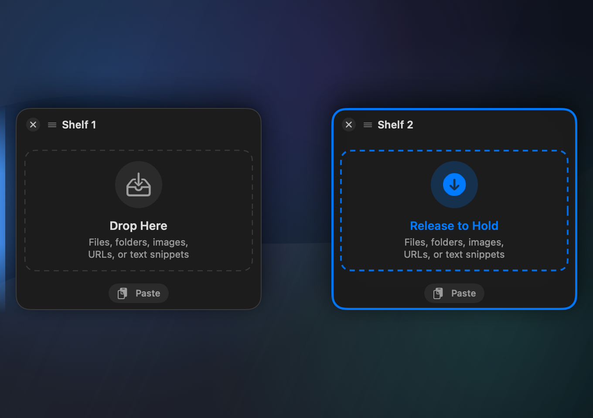
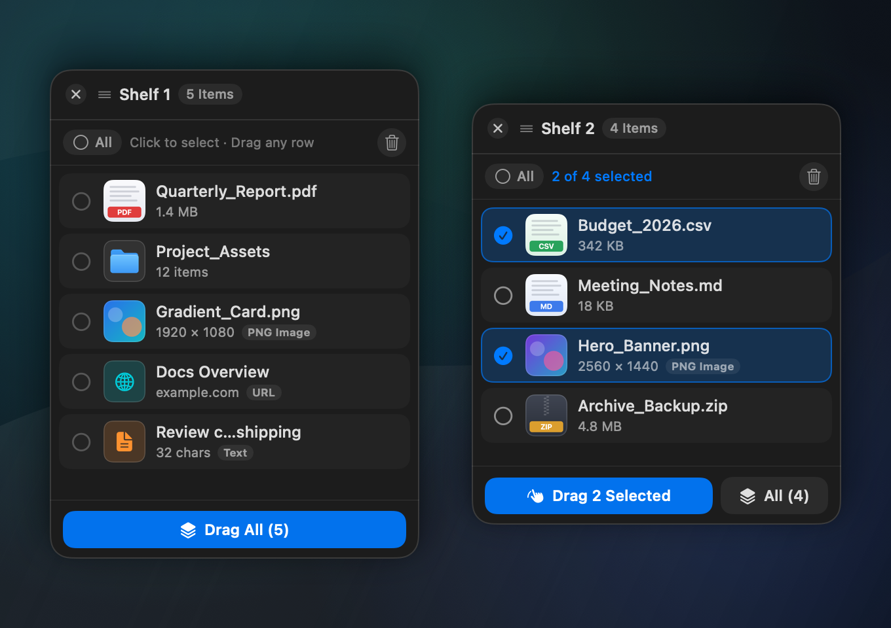
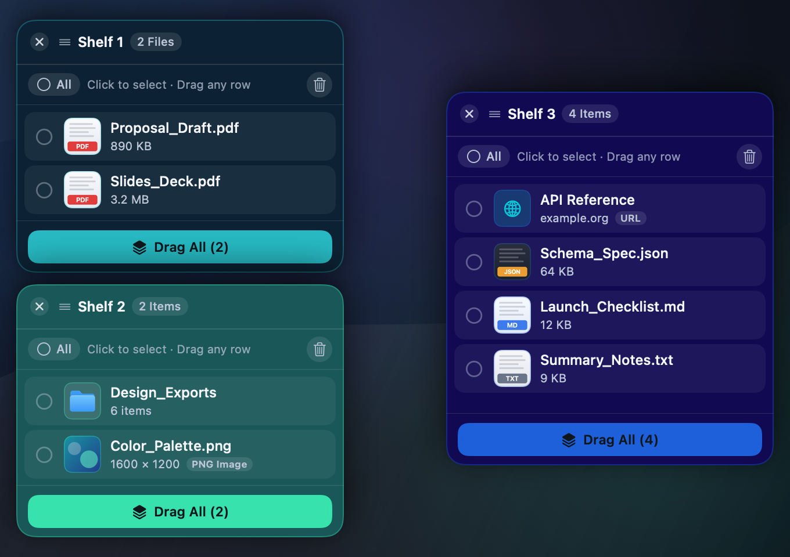
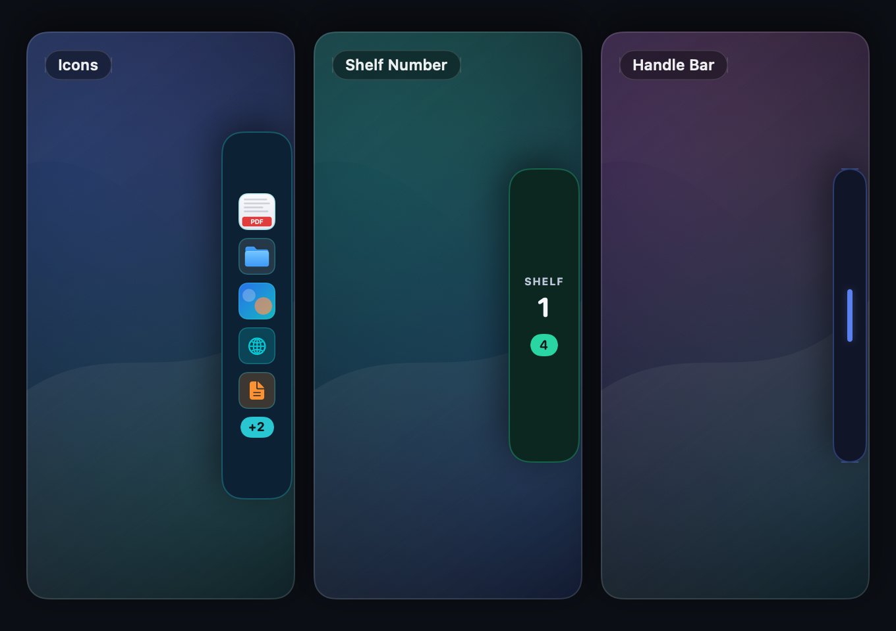
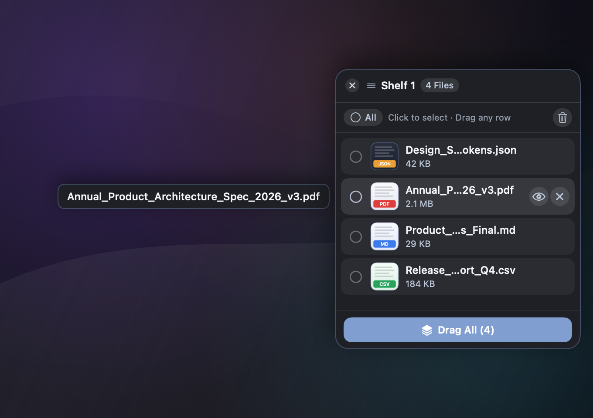
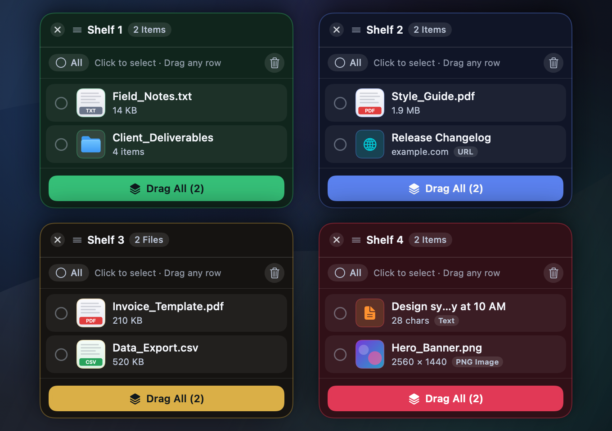

<p align="center">
  
</p>

<h1 align="center">Droptop</h1>

<p align="center">
  A native, open-source multi-shelf drag-and-drop utility for macOS (Apple Silicon).<br>
  Drag files, folders, images, URLs, or text snippets to the screen edge — pick them up anywhere.
</p>

<p align="center">
  <a href="https://github.com/MobiusGT/Droptop/releases">
    
  </a>
  
  
</p>

---

## What is Droptop?

Droptop provides floating, non-activating edge shelves that sit above your windows across macOS Virtual Desktops (Spaces) without stealing focus from Finder or your active app. Drag items to the left or right edge of your screen to drop them into a shelf, switch apps or desktops, and drag one, several, or all items right back out.

## Screenshots

<table>
  <tr>
    <td align="center" width="50%">
      <br>
      <sub>Screen-edge drop zone &amp; glow</sub>
    </td>
    <td align="center" width="50%">
      <br>
      <sub>Multi-type items &amp; selection</sub>
    </td>
  </tr>
  <tr>
    <td align="center" width="50%">
      <br>
      <sub>Multi-shelf color variation</sub>
    </td>
    <td align="center" width="50%">
      <br>
      <sub>Auto-Hide edge styles</sub>
    </td>
  </tr>
  <tr>
    <td align="center" width="50%">
      <br>
      <sub>Hover full-name reveal</sub>
    </td>
    <td align="center" width="50%">
      <br>
      <sub>Built-in themes</sub>
    </td>
  </tr>
</table>

## Features

### Multi-Shelf & Drag-and-Drop
- **Multiple independent shelves** — create as many shelves as you need on the left and right edges, each numbered (`Shelf 1`, `Shelf 2`, …).
- **Selectable item lists** — click, `⌘`-click, `⇧`-click, or use **All / None** to take a single item, a multi-selection, or everything from a shelf at once.
- **5 supported payload types** — files, folders, images, web URLs, and text snippets (with native AppKit `NSPasteboard` and `NSFilePromiseProvider` support).
- **Dock folder stack compatible** — drag files straight out of folders pinned in the macOS Dock to trigger new shelves or drop into existing ones.
- **Steady full-name reveal on hover** — hovering truncated long filenames displays a clean anchored tooltip pill right next to the shelf without text jitter.

### Auto Hide, Positioning & Spaces Support
- **Auto Hide with Clean Auto hide styles**:
  - **Icons** — peeks just your file icons along the edge.
  - **Shelf Number** — shows a clean numbered badge and item count.
  - **Handle Bar** — collapses to a slim themed accent strip.
  - Smooth edge-growing unhide animation and instant resizing when switching styles.
- **Free repositioning & deterministic side switching** — drag any shelf up/down by its header or past the screen's horizontal halfway line to snap to the left or right edge (using a custom drag loop that never triggers macOS's half-screen window tiling animation).


### Themes & Appearance
- **Built-in themes** — Optional themes to suit your preferences 
- **Shelf color variation** — keep Shelf 1 in the base theme while subtly shifting Shelf 2, 3, … within the same color family for easier management of multiple shelves.

### Additional Triggers
- **Screen-edge drag** (enabled by default on both left and right edges, with optional glow indicator).
- **Shake while dragging** (optional).
- **Custom global keyboard shortcut** (optional, default `⌘⇧Space`).
- **Menu bar app** (`LSUIElement`) with quick shelf switcher, clipboard-to-shelf creation, theme picker, and Launch at Login.

---

## Installation

### Download
Get the latest `Droptop.dmg` from the [Releases page](https://github.com/MobiusGT/Droptop/releases/latest) (or [direct download](https://github.com/MobiusGT/Droptop/releases/latest/download/Droptop.dmg)).

1. Download and open `Droptop.dmg`
2. Drag **Droptop** into the **Applications** folder
3. Launch **Droptop** from Applications (if macOS warns about an ad-hoc signed build, right-click → **Open** or allow it in **System Settings → Privacy & Security**)
4. Optional: grant **Accessibility** permission in Settings if you want global keyboard shortcuts (screen-edge dragging works out of the box)

### Build from Source

Requires **Xcode 16+** and **macOS 15+** (Apple Silicon `arm64`).

```bash
git clone https://github.com/MobiusGT/Droptop.git
cd Droptop
xcodebuild -project Dropi.xcodeproj -scheme Dropi -configuration Release ARCHS=arm64 CODE_SIGN_IDENTITY=- CODE_SIGNING_REQUIRED=NO build
```

Or open `Dropi.xcodeproj` in Xcode and build the `Dropi` scheme (which produces `Droptop.app`).

---

## Usage

| Action | How |
|--------|-----|
| **Open shelf** | Drag a file/item to the left or right screen edge, press your hotkey, or click **New Shelf** in the menu bar |
| **Add items** | Drop files, folders, images, URLs, or text onto a shelf, or click **Paste** |
| **Select items** | Click a row, `⌘`-click for multiple, `⇧`-click for a range, or click **All / None** |
| **Drag back out** | Drag any row (or selected rows) or use the bottom **Drag Item / Drag Selected / Drag All** pill |
| **Move / switch sides** | Drag a shelf's header up/down or past the horizontal center of the screen to dock on the opposite edge |
| **Inspect long names** | Hover over a truncated filename to display the full name next to the shelf |
| **Settings & Themes** | Click the gear icon on any shelf or choose **Settings…** from the menu bar |

---


## Tech Stack

- Swift / SwiftUI
- AppKit (`NSPanel`, `NSDraggingSource`, `NSDraggingDestination`, `NSFilePromiseProvider`)
- macOS 15+ (Apple Silicon `arm64`)

---

## Attributions

**Droptop** is a modified fork and derivative of **[Dropi](https://github.com/akinalpfdn/Dropi)**, originally created by **[akinalpfdn](https://github.com/akinalpfdn)** and released under the [GNU General Public License v3.0](LICENSE).

- Full credit for the original concept, project foundation, app icon assets, and open-source Swift/AppKit shelf architecture goes to **[akinalpfdn](https://github.com/akinalpfdn)** ([akinalpfdn/Dropi](https://github.com/akinalpfdn/Dropi)).
- In accordance with the GNU GPLv3, Droptop remains completely free and open source under the same [GPLv3 license](LICENSE).

---

## Ai Disclosure

- **All changes, fixes, and new features in Droptop** were made with **Gemini 4 Neon xhigh**.
  
---

## License

This project is licensed under the **[GNU General Public License v3.0](LICENSE)** — derived from [akinalpfdn/Dropi](https://github.com/akinalpfdn/Dropi).
